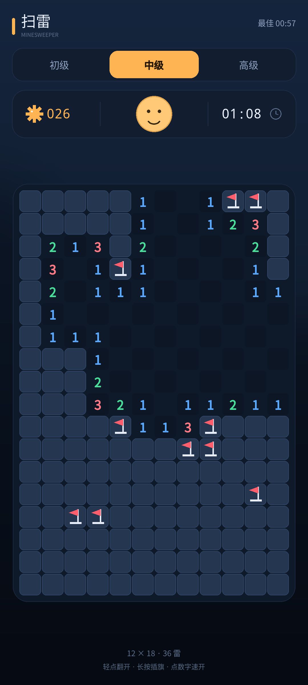

# 扫雷 · Minesweeper



> 上图是按真实布局绘制的界面示意图（非真机截图）。

一个原生 Android 扫雷小游戏：单 Activity、纯 Java 自绘棋盘，无任何第三方运行时依赖，APK 很小。

## 玩法

- **轻点**：翻开格子；数字表示周围 8 格的雷数。
- **长按**：插旗 / 取消插旗。
- **点数字**：周围插够旗时，自动翻开其余相邻格。
- 第一下永远不会踩雷，并且会展开一片空白区。
- 三档难度：初级 9×9 / 10 雷，中级 12×18 / 36 雷，高级 16×24 / 80 雷。
- 每档难度单独记录最佳成绩（本地保存）。

## 构建

云端构建（推荐，手机环境无需 JDK / Android SDK）：

- GitHub Actions 会自动执行 `gradle :app:test :app:assembleRelease`。
- 产物：`app/build/outputs/apk/release/app-release.apk`。
- Release 使用仓库内 `keystore/minesweeper.p12` 固定签名，覆盖安装不会失败。
  （公开仓库里的玩具签名，别用于正式上架。）

本地构建需要 JDK 17 + Android SDK 34：

```bash
gradle :app:assembleRelease
```

## 代码结构

```
app/src/main/java/com/dsh/minesweeper/
├── Game.java       纯 Java 规则：布雷、翻格、连锁展开、插旗、快速展开
├── GameView.java   自绘界面：标题/难度/计时/棋盘/结算层/彩纸
└── MainActivity.java
app/src/test/java/com/dsh/minesweeper/GameTest.java   规则单元测试
tools/make_icons.py                                   启动图标生成脚本
```
